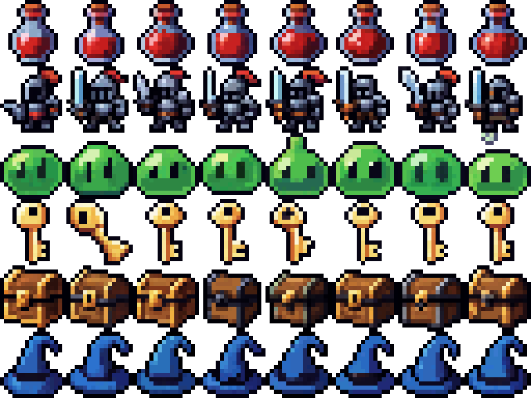
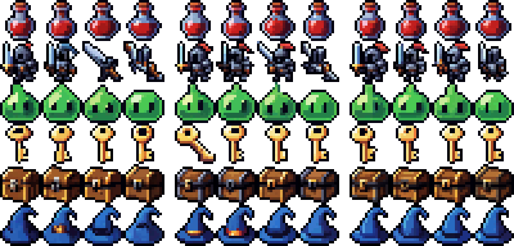

# mini-pixel-art

Tiny text-to-image models (1.9M–8.8M parameters) for 16×16 pixel-art sprites. They work directly in pixel space, with no VAE and no pretrained text encoder, and run in a browser with WebGPU.



*M-P1, 16 steps, seeds 0–7. Captions top to bottom: red potion bottle · side-view knight with sword · green slime · golden key · wooden treasure chest · blue mage hat. Not cherry-picked.*

**[Try it in your browser →](https://anticpan.github.io/mini-pixel-art/)** (WebGPU, falls back to CPU; nothing is uploaded)

Code: [github.com/AnticPan/mini-pixel-art](https://github.com/AnticPan/mini-pixel-art) · Weights: [huggingface.co/AnticPan/mini-pixel-art](https://huggingface.co/AnticPan/mini-pixel-art)

## Models

| Model | Params | Width × blocks | Patch | Web demo weights | Notes |
|---|---|---|---|---|---|
| `s-p1` | 1.93M | 128 × 6 | 1×1 | fp32, 7.7 MB | Smallest; noticeably lower subject accuracy |
| `m-p1` | 4.35M | 192 × 8 | 1×1 | int8, 4.5 MB | **Recommended** balance of quality, size and speed |
| `l-p1` | 8.75M | 256 × 10 | 1×1 | int8, 9.0 MB | Best quality; about 1.8× slower than m-p1 |
| `m-p2` | 4.36M | 192 × 8 | 2×2 | fp32, 17.4 MB | Each token covers 2×2 pixels (64 pixel tokens instead of 256): about 2.5× faster than m-p1, a bit less detail |



*Left to right: s-p1, m-p1, l-p1, with the same noise (seeds 0–3) and the same six captions as above.*

All models are single-stream DiTs with 4 heads. Text is split into words and looked up in a 10,944-word table built from the training captions. Each image is predicted as continuous RGBA in [-1, 1], then each pixel is snapped to the nearest colour in the dataset's 4,096-colour palette (pixels with alpha < 0 become transparent).

## Usage

```bash
pip install torch numpy safetensors pillow
python mini_pixel_art.py --model m-p1 --n 8 "red potion bottle" "side-view knight with sword" --out sheet.png
```

```python
from mini_pixel_art import Pipeline
pipe = Pipeline(".", "m-p1")                # or device="cuda"
rgba = pipe(["golden key", "green slime"], seed=0)    # uint8 [2, 16, 16, 4]
```

**ONNX** (no PyTorch): each model also ships as `model.onnx` (opset 17, fp32, dynamic batch). Inputs are `z` [B,4,16,16] float32, `t` [B] float32 (1 = noise, 0 = clean) and `cap_ids` [B,12] int64; the output `x` is the predicted clean image. `mini_pixel_art_onnx.py` contains the same sampling loop in numpy:

```bash
pip install numpy onnxruntime pillow
python mini_pixel_art_onnx.py --model m-p1 --n 8 "golden key" "green slime" --out sheet.png
```

On the same noise, the ONNX models match PyTorch to within 2e-5 per forward pass, and 16-step generation gives identical pixels. Numpy noise differs from torch noise, so the same `--seed` gives different images in the two scripts.

Default sampler (in each `config.json`): 16 Euler steps, classifier-free guidance 1.5 on RGB and 1.5 on alpha (1.0 on alpha for l-p1), and the grid stops at t = 0.05, with the last step jumping straight to the prediction. **Keep `t_stop = 0.05`.** The models were trained with `max(t, 0.05)` in the loss, so their predictions below t = 0.05 are biased. A uniform grid with more than 16 steps evaluates there and gets *worse* as you add steps.

Captions work best when written like the training data: short noun phrases, optionally starting with a view word (`front-view`, `three-quarter-view`, `top-down`, `side-view`). Words not in the vocabulary are ignored; the script prints them.

## Evaluation

All numbers use 4,096 held-out captions with their real images. These are rows randomly held out from the official *train* split and never used in training. The official validation split has no view words and shorter captions, so it is only used to pick sampler settings.

| Model | Params | Subject hit ↑ (real 0.733) | Feature Fréchet ↓ | Real/fake AUC ↓ (0.5 = indistinguishable) | Colours / image (real 22.3) |
|---|---|---|---|---|---|
| s-p1 | 1.93M | 0.609 | 6.02 | 0.557 | 53.6 |
| **m-p1** | 4.35M | 0.692 | 5.41 | 0.533 | 50.7 |
| l-p1 | 8.75M | 0.714 | 4.96 | 0.528 | 47.9 |
| m-p2 | 4.36M | 0.684 | 5.84 | 0.536 | 66.7 |
| UbaNova-16 | 42.4M | 0.448 | 9.62 | 0.786 | 21.1 |
| tessera-small | 47.6M | 0.693 | 13.31 | 0.703 | 19.5 |
| pixelsprite-canvas-v2 | 39.1M | 0.430 | 7.16 | 0.630 | 23.8 |

- Our rows use the release sampler (16 steps, `t_stop` 0.05) with fp32 compute, and the same weights as the web demo: int8 for m-p1 and l-p1, fp32 for s-p1 and m-p2.
- **Subject hit**: a classifier trained on real images predicts the subject (out of 6,194) of each generated image; we report top-1 accuracy. **Feature Fréchet**: Fréchet distance in that classifier's feature space. **Real/fake AUC**: a small CNN is trained on 20k real vs 20k generated images from training captions, then tested on the held-out set.
- None of the 4,096 generated images is an exact copy of a training image.
- **The comparison is not even-handed. Read it as a rough reference.**
  - The community models use their model-card defaults, with no tuning, and their own palettes. Their outputs were mapped to our palette before scoring.
  - Our held-out rows come from the official train split, which those models were likely trained on. This favours them.
  - Their parameter counts exclude their frozen text encoders.
  - Their numbers come from an earlier run (32 steps), not from the release setting.
- Ours is one training seed per model. Two seeds of m-p1 differed by at most 0.012 AUC and 0.03 Fréchet.

Speed for 16 steps with guidance, excluding text preprocessing:

| | s-p1 | m-p1 | l-p1 | m-p2 |
|---|---|---|---|---|
| Browser, WebGPU (Apple-silicon Mac, batch 8) | ~70 ms / image | ~130 ms | ~210 ms | ~48 ms |
| PyTorch CPU, 4 threads, batch 1, fp32 | ~134 ms | ~250 ms | ~430 ms | ~100 ms |
| RTX 5090, batch 1024, bf16 | 1,799 images / s | 873 | 532 | 3,168 |

## Limitations

- **Smoother than hand-made pixel art.** Shapes and colours are usually right, but edges and detail are softer than in the training images or the larger community models.
- **Near-duplicate colours.** Flat colour areas are often split into several colours a few levels apart: about 51 colours per image versus 22 in real sprites. This is mostly invisible at 1× but matters if you need a tight palette. fp32 inference helps a lot compared with bf16 (68 → 51 colours).
- **int8 weights only for m-p1 and l-p1.** Both stay within tolerance of fp32 on all four metrics. For m-p2 and s-p1, int8 weights look the same to the eye but measure worse (m-p2: real/fake AUC 0.536 → 0.722; s-p1: Fréchet 6.02 → 6.27, AUC 0.557 → 0.586), so the demo loads their fp32 weights.
- **Closed vocabulary.** Only the words and subjects in the training captions are known. The model does not generalise to unseen subjects. Captions in the dataset are approximate, so attributes such as counts and materials are followed loosely.
- **Single training seed** per released model. Claims above are candidates, not settled results.

## Training

- **Data**: [Angais/pixel-art-atlas-1.4m](https://huggingface.co/datasets/Angais/pixel-art-atlas-1.4m), 1.4M synthetic 16×16 sprites with captions, minus 4,096 held-out rows.
- **Objective**: flow matching with x-prediction and velocity loss; t is sampled from a logit-normal distribution; captions are dropped 10% of the time for guidance.
- **Optimisation**: AdamW at lr 1e-3 with 5k warm-up, batch 512, 300k steps, EMA 0.9999. One RTX 5090 for about 2.5 / 5 / 8.5 hours (s / m / l).

## Files

```
mini_pixel_art.py           standalone inference (torch only)
mini_pixel_art_onnx.py      the same with onnxruntime + numpy
<model>/model.safetensors   fp32 EMA weights, for <model> in s-p1, m-p1, l-p1, m-p2
<model>/model.onnx          the same weights as ONNX (opset 17, fp32)
<model>/config.json         architecture and default sampler
vocab.json                  word -> id (ids 0/1/2 are pad / unk / null)
palette.bin                 4097 × RGB uint8 (index 0 = transparent)
docs/index.html             the web demo (served by GitHub Pages from /docs)
docs/models/                weights for the demo, downloaded only when a model is selected
```

## License

Code and weights: [MIT](LICENSE).

The weights were trained from scratch. They contain no part of any other model's weights. The only training data was [Angais/pixel-art-atlas-1.4m](https://huggingface.co/datasets/Angais/pixel-art-atlas-1.4m), released under CC0 1.0. According to its card, its sprites were generated with Krea 2 Turbo and a pixel-art LoRA, and its CC0 dedication does not override the [Krea 2 Community License](https://www.krea.ai/krea-2-licensing) or the [Krea Acceptable Use Policy](https://www.krea.ai/krea-2-use-policy). See [NOTICE](NOTICE). This project is not affiliated with or endorsed by Krea or the dataset author.
